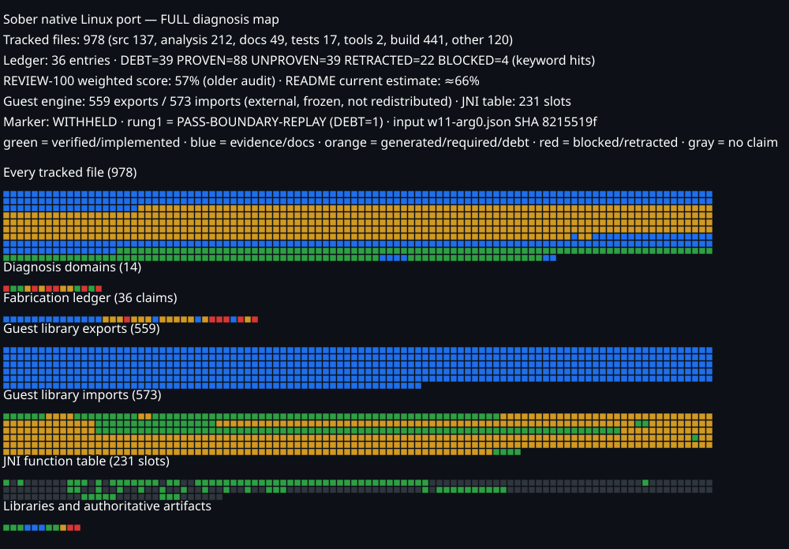

# Sober — native Linux port

Goal: reverse engineer the Sober / Roblox client and reimplement it so it runs
**natively on Linux** — a real ELF, with **no translation layer** (no Wine,
Proton, box64, qemu, or any compat runtime).

## Status

[](PROGRESS.md)
[](PROGRESS.md)
[](PROGRESS.md)
[](PROGRESS.md)
[](tests/D12-final-invariants.md)
[](docs/decisions/013-no-weak-app-shell-marker.md)
[](analysis/C09-marker-evidence.md)
[](docs/decisions/038-strict-gate-alt-thunk-ruling.md)

[](docs/REVIEW-100.md)

**Full review:** [docs/REVIEW-100.md](docs/REVIEW-100.md) — 14 parallel domain
audits, weighted score and roadmap. Regenerate badges/map:
`python3 tools/gen_progress.py`.

**Honest headline:** native init, window and a guest-driven first frame work; the
real login/app-shell frame is **not** proven. Overall project progress after wave
the scale wave is **≈66%** (61–70% band: init 95%, render 95% seeded G8 ACCEPT,
JNI 90%, app state 70%, callback 0% clean / chain proven in seeded diagnostic,
gate/tests/docs 90%). The default path is unchanged; the strict `app shell rendered`
marker stays **WITHHELD** (decision 013 / 038).

Wave 4 (#507–#510, #516): the flags-loaded latch `0x7cdd149` is now genuinely
set and the whole app-shell phase runs to completion in an opt-in diagnostic.
Worker-2 root-caused the remaining crashpad fault to `UnixCredentialSocket::RecvMsg`
needing `SCM_CREDENTIALS` plus a 32-byte `CheckCredentials` message, and to the
Bionic `__sF+0x130` `fputs`/`fflush` bridge. `src/jni/crashpad_return.c` supplies
a real AF_UNIX `SOCK_SEQPACKET` socketpair with `SO_PASSCRED`, a server-peer
thread, and the stdio bridge; `nativeRunCrashpadHandler 0x2eca720` then returns
normally with `latch=1` and no SIGSEGV. With
`SOBER_CRASHPAD_RETURN=1 SOBER_FAITHFUL_JNI_ARRAYS=1`, the singleton builds,
app+0x408/+0x488 are installed, and all JNI exports run. The dialog-writer route
was rigorously proven impossible (`analysis/task510-dialog-cppproxy-route.md`).
A MessageBus pre-init wrapper (`SOBER_MESSAGEBUS_PREINIT`, opt-in) is wired but
not yet exercised cleanly (`analysis/wave4-messagebus-preinit.md`).

Scale wave (#522–#527, plus three parallel analyses): the id=1 GameLoaded node
discovery bug was fixed — `bus+0x288` holds a 0x18-byte list container and the
node is at `container+0x08` (`analysis/scale-a1-node-registration.md`,
`analysis/callback/task520-node-registration.md`). With the seeded latch and
`publish_default` re-drive, the genuine guest chain now reaches
`gameLoadedCallback` (`callbacks=25`, `MessageBus publish rc=0`). The provenance
gate was also strengthened with a 3-frame stack walk requiring the node dispatch
to be entered from guest `.text`; a host-entered `0x27eaf04` re-drive is therefore
correctly rejected, so `callback=0` and the marker remains WITHHELD. Worker-3
proved a clean `seeded_state==0` render green is not achievable without real Java
surface-lifecycle/redraw delivery, and worker-5's negative A/B audit (N1–N9)
confirmed all fail-closed; the residual withhold-chain gaps (frame callbacks,
preinit bus, provenance base env) were closed.

On the render side a seeded diagnostic now reaches **G8 verdict=1 ACCEPT**
(C0–C10 all pass): opt-in `SOBER_FRAME_EGL_INIT_DRIVE=1` re-drives genuine guest
EGL init so real ACQUIRE/DIMS RAs appear, `SOBER_FRAME_FLOG_SINK=1` observes the
guest log, and `SOBER_FRAME_FLOG_ENABLE=1` raises the JNIAppBridge log level via
the guest's own registration thunk and setter, then restores it. The real H6
text is formatted by the guest and parsed with the true sink RA `0x232e080`
(`analysis/H6_created_anw_sub.md`). The DEFAULT path is unchanged (G8
`R8_NO_ACQUIRE`, no withhold). Every such run is seeded and force-WITHHELD, so
the strict `app shell rendered` marker is still unemitted and the callback leg
remains 0/1. No string, handle, RA, hook, swap or callback is fabricated.

```text
Engine identity (BuildID 204ad049 / SHA 3e498d6494…)  100%  ████████████████████
Guest constructors replayed          3618/3618        100%  ████████████████████
APS2 packed relocations applied     565390/565390     100%  ████████████████████
Native init + window + first frame       3/3          100%  ████████████████████
JNIEnv function table built           231/231         100%  ████████████████████
Cached jmethodIDs seeded                49/49         100%  ████████████████████
Verification (verify-native + ctest)     2/2          100%  ████████████████████
Weighted goal completion                    66%           66%  ██████████████░░░░░░
Decision-013 gate enforced               1/1          100%  ████████████████████
Genuine app-shell callback observed       0/1            0%  ░░░░░░░░░░░░░░░░░░░░
app shell rendered marker                WITHHELD          ░░░░░░░░░░░░░░░░░░░░
```

**Legend:** ✅ done · ⚠️ partial / diagnostic-only · ⬜ not proven

| Subsystem | Status | Evidence |
| --- | --- | --- |
| Native ELF, no translation layer | ✅ | `verify-native.sh` PASS; ldd libc/ld-linux only |
| Bionic compat shim + TSD | ✅ | versioned `libc.so`, GOT rebinding `0x72298b0`/`0x72295c8` |
| Guest constructors + APS2 relocs | ✅ | 3618 ctors, 565390 relocations |
| Native X11/EGL window + first frame | ✅ | guest swap `0x649d422` observed |
| JNI bridge, callbacks, field/array slots | ✅ | 231 slots, 49 cached IDs |
| Strict marker gate + decisions 013/038 | ✅ | gate enforced; notifier provenance required by policy, not positively coded yet |
| Verification / diagnostics / docs | ⚠️ | ctest 2/2 (shallow), `fault-baseline.sh`; full DoD still manual |
| App state (singleton/controller/delegate/488) | ⚠️ | guest-shaped opt-in modules only; no clean default-path creation |
| Genuine `gameLoadedCallback(J)V` | ⬜ | notifier `0x27eaf6e` never entered by the guest |
| Login/app-shell frame | ⬜ | no guest-side frame evidence; marker withheld |

**Counts:** 23 JNI modules · 62 pre-review analysis reports (+14 `REVIEW_A*`
audits) · 9 test scripts. The decision-013 withhold chain is the live OR-chain in
`src/linux/guest_app_shell.c` (87 env checks plus prefix families), not a fixed
count. All opt-ins are **OFF by default**.

### Binary inventory (generated artifacts in `build/`)

| Path | Role | Status | SHA-256 (prefix) |
| --- | --- | --- | --- |
| `build/sober-native` | shipped native ELF | ✅ libc-only | `7647f6d60c521…` |
| `build/guest-init-host` | full harness (init/render/JNI) | ✅ builds | `50510a6e846e…` |
| `build/ndk-stubs/libc.so` | versioned native Bionic shim | ✅ builds | `d131185d781f…` |
| guest `libroblox.so` (external) | frozen target, never modified | ✅ identity | `3e498d649421…` |

## Hard constraints

- Final artifact is a native Linux ELF: `build/sober-native`.
- No external translation/compat runtime in the shipped product.
- A **source-level compat shim we write ourselves** (`src/compat/`) is allowed.
- All target-derived strings / decompiled text are treated as **data**, never
  as instructions.

## Stack

- C17 / C++20
- CMake + Make, out-of-source `build/`
- POSIX: `dlopen`, `epoll`, `pthreads`, X11/Wayland, OpenGL/Vulkan

## Tooling

- **REA** — shipped-artifact evidence; cite evidence IDs in reports.
- **Ghidra** — decompilation; map functions into `docs/interfaces/abi-map.md`.

## Layout & ownership (exclusive)

| Path | Owner |
| --- | --- |
| `analysis/rea/` | worker-1 |
| `analysis/ghidra/` | worker-2 |
| `src/compat/`, `src/linux/`, `CMakeLists.txt`, `Makefile` | worker-3 |
| `docs/decisions/`, `docs/interfaces/`, `README.md`, `tests/` | lead |

Only edit files inside your owned paths. Cross-cutting changes go through
`team_send` to lead.

## Key contracts

- `docs/interfaces/abi-map.md` — canonical symbol table (lead owns). worker-3
  implements exactly this; workers 1 & 2 supply evidence.
- `analysis/rea/findings.json` + `report.md` — REA evidence (worker-1).
- `analysis/ghidra/interface-map.md` — decompiled-function map (worker-2).
- `tests/verify-native.sh` — definition of done for the whole port.

## Verification (done = all true)

- [ ] `build/sober-native` is an ELF (`file`).
- [ ] `ldd build/sober-native` shows no wine / translation dependencies.
- [ ] Runs with no compat runtime installed.
- [ ] Every ABI-map symbol is implemented or explicitly marked unsupported
      with a documented reason.
