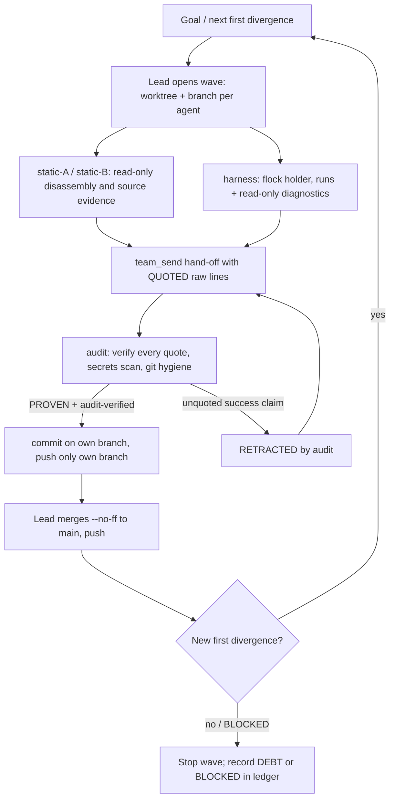

# Project workflow — schema and rules

This document is the canonical description of how a wave of work runs. It is
the "schema" of the project workflow: who owns what, what evidence is required,
how claims move to the ledger, and how a branch reaches `main`.

## 1. Pipeline

## 2. Agent roles and ownership

| Role | Owns | May do | Must not do |
| --- | --- | --- | --- |
| static / static-A / static-B | `/tmp/opencode/wNN-<role>/`, branch `wNN-<role>` | read-only disassembly, source/capture search, proposed diffs | apply diffs, run harness, edit ledger |
| harness | `/tmp/opencode/wNN-harness/`, branch `wNN-harness`; sole holder of `flock /tmp/opencode/harness.lock` | host-only diagnostics/runs, trace hookups, run D ×3 | guest writes, gate edits, fake JNI returns, path remaps |
| audit | `/tmp/opencode/wNN-audit/`, branch `wNN-audit` | verify raw lines, sole editor of `analysis/FABRICATION-LEDGER.md`, secrets scan, git checks | device work, harness runs, guest/host source edits |
| lead | coordinates, merges, logs | merge audit-verified branches only, `README.md`, `docs/`, `MORNING.md`/`OVERNIGHT-LOG.md` | force-push, merge unverified branches |

Heavy static commands may be core-capped (e.g. `taskset -c 2,3`). Evidence logs
are capped at 50 MB each; nothing is deleted.

## 3. Evidence ladder

1. **Capture / raw file** — existing `w11-*.txt`, `w12-j2n-300.log`, `w11-arg0.json`,
   frozen engine. No new captures unless explicitly authorised.
2. **Static disassembly** — `objdump`/REA lines quoted verbatim, with RVAs.
3. **Entry / call-site breakpoints and ring buffers** — read-only. The preferred
   dynamic evidence. When naming a fault: **name the faulting instruction first**,
   then interpret registers. A return address on the stack is never the faulting
   instruction.
4. **Audit** — every PROVEN claim must quote its raw line. Unquoted success is
   RETRACTED. Fault-site claims must state the configuration (with/without
   breakpoints), because instrumentation changes the observed site.

Ledger claim states: `PROVEN`, `UNPROVEN`, `RETRACTED`, `BLOCKED (reason)`,
`DEBT=n`. `DEBT` counts active host-side workarounds, diagnostic toggles or
value substitutions that must be removed before a clean marker claim.

## 4. Gate and ladder rules

- Rung 1 credential: **latch byte read-only before = 0 and after = 1**, plus a
  real `[W21_LATCH_HIT]` line when the watcher is armed, and SHA `8215519f…`
  verified. Never infer from `latch=1` alone.
- Rung 1 label is always `PASS-BOUNDARY-REPLAY (DEBT=n)` while replay state is
  active; never `CLEAN`.
- Rung 2 (AppStart, V2InitWithParams, StartLuaAppDM; refs #727/#734/#736) is
  attempted only after the recursion is gone. "Reached" requires a quoted
  `StartLuaAppDM` line from the harness log on the authoritative input.
- `app shell rendered` marker stays WITHHELD until decisions 013 / 038 are
  satisfied.
- Replaying captured natives to remove a recursion is host-only and is **not**
  a rung-2 attempt (ledger 35).

## 5. Pre-approved decisions

1. A host-only fix for a harness-introduced defect (crash handler, diagnostics,
   replay order, host-built object): apply it, add a ledger entry, rerun.
2. If the chain ends in harness-fabricated state: turn it OFF by default with a
   ledger entry and rerun.
3. A run hanging >10 min: kill, record `rc=124`, do not loop.
4. If the faulting instruction changes, it becomes the new first divergence;
   restart the loop with the same method.
5. Guest writes, gate edits, fake returns, path remaps and fabricated handles
   are **BLOCKED**, not decisions to make locally.

## 6. Overnight extension

The overnight brief extends the same loop with: one worktree per agent under
`/tmp/opencode/n1-<role>/`; 4 workers maximum (lead + harness + two static
analysts + audit); rate limit → wait 5 min, retry 3×, then `BLOCKED`; hard stops
after 8 hours, 6 waves, or 2 consecutive waves with no new PROVEN. Lead appends
one line per wave to `/tmp/opencode/OVERNIGHT-LOG.md` and writes a one-page
`/tmp/opencode/MORNING.md` at stop. See the log for the n1-1…n1-5 wave record.

## 7. Current open item

`BLOCKED` (ledger 36): the #552 argument is `[object Object]` in the capture,
with no recoverable type/fields/handle; both candidate objects fault at
`[rdi+8]`; no genuine closure pointer exists in scanned guest state. Resolving
it needs either a new genuine capture of that argument or a policy decision on
constructing a documented bridge object — neither is available inside the
current rules. Until then, the recursion described in the README remains the
first divergence.
